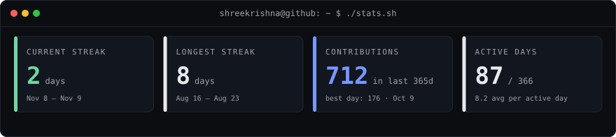
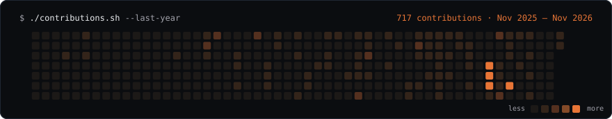

<div align="center">



<a href="https://readme-typing-svg.demolab.com"></a>

<p>
<a href="https://shreekrishnachinta.vercel.app"></a>
<a href="https://linkedin.com/in/shreekrishna-chinta"></a>
<a href="mailto:shrikrishnachinta79@gmail.com"></a>
</p>


</div>

## `~/ $ whoami`

<div align="center">

</div>

AI & Data Science undergrad @ AISSMS IOIT, Pune. I build end-to-end intelligent products — database schema to shipped interface — with a soft spot for 3D, motion and developer tooling. Off the keyboard: student-athlete, currently losing arguments with feature-engineering pipelines in public.

## `~/ $ cat stack.md`

**Languages**


**Frontend**


**Backend & Data**


**AI & Data Science**

     

<sub>also playing with Ollama · LangChain · Whisper · OpenRouter</sub>

**Tooling**


## `~/ $ ls projects/ -l`

<table>
<tr>
<td width="50%" valign="top">

### [obsync-plugin](https://github.com/chintu79/obsync-plugin)
Local-first P2P sync for Obsidian vaults — no cloud, no account. Encrypted, peer-to-peer, your notes never touch a server.

`TypeScript` `Obsidian API` `P2P`

</td>
<td width="50%" valign="top">

### [promptocalypse](https://github.com/chintu79/promptocalypse)
AI jailbreak arena — a real-time red-team CTF where attackers extract hidden keys from progressively defended LLM chatbots.

`FastAPI` `React 19` `Groq` `SQLite`

</td>
</tr>
<tr>
<td width="50%" valign="top">

### [devs_second_brain](https://github.com/chintu79/devs_second_brain)
Developer knowledge OS — capture, connect and rediscover notes, prompts and resources. Ships with a Chrome extension for one-click capture.

`JavaScript` `Chrome Extension`

</td>
<td width="50%" valign="top">

### [argus](https://github.com/chintu79/argus)
Budget-constrained adaptive security evaluation of AI agents — research prototype on efficient failure discovery under a fixed evaluation budget.

`Python` `LLM Agents` `Security`

</td>
</tr>
</table>

More on the portfolio — **CareerOS**, **GrammarRx AI**, an **Interactive 3D Experience** → [shreekrishnachinta.vercel.app](https://shreekrishnachinta.vercel.app)

## `~/ $ ./stats.sh`

<div align="center">






<sub>stats &amp; graph generated daily from real data via <a href=".github/workflows/update-profile-art.yml">GitHub Actions</a> — never hardcoded</sub>

</div>

<details>
<summary>🚫 <b>.hidden — do not open</b></summary>

<br/>

You weren't supposed to find this.

I'm a student-athlete who codes between training sessions. Most of my best ideas arrive mid-sprint. If you're an engineering team, a collaborator, or a fellow student-builder — [my inbox](mailto:shrikrishnachinta79@gmail.com) is open, and I take interesting problems more seriously than most internship applications.

📜 Terms: zero contribution streaks were harmed in the making of this profile.

</details>

## `~/ $ ./connect.sh`

<table align="center">
<tr>
<td valign="middle" width="130">

</td>
<td valign="middle">

**Let's build something worth shipping.**

Currently into feature engineering, EDA and agent-security research — and open to internships, collaborations and interesting open problems in AI · DS · Web Dev.

→ [portfolio](https://shreekrishnachinta.vercel.app) · [linkedin](https://linkedin.com/in/shreekrishna-chinta) · [github](https://github.com/chintu79) · [email](mailto:shrikrishnachinta79@gmail.com)

</td>
</tr>
</table>

<div align="center">

```
shreekrishna@github ~ $ exit
logout — thanks for scrolling. ▌
```


</div>
